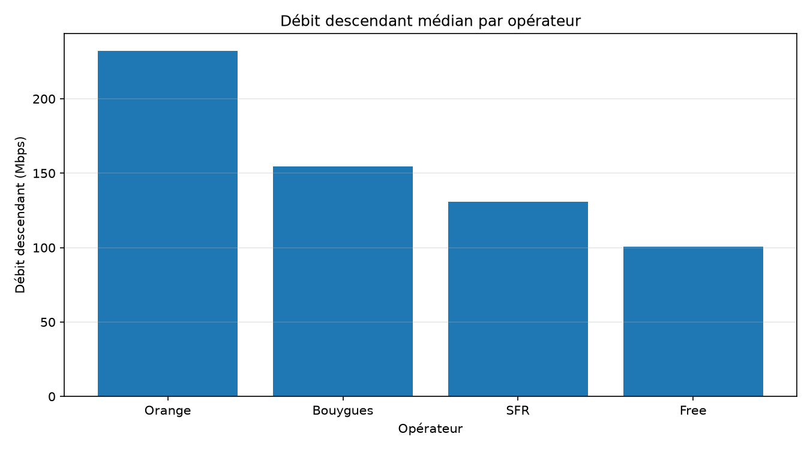
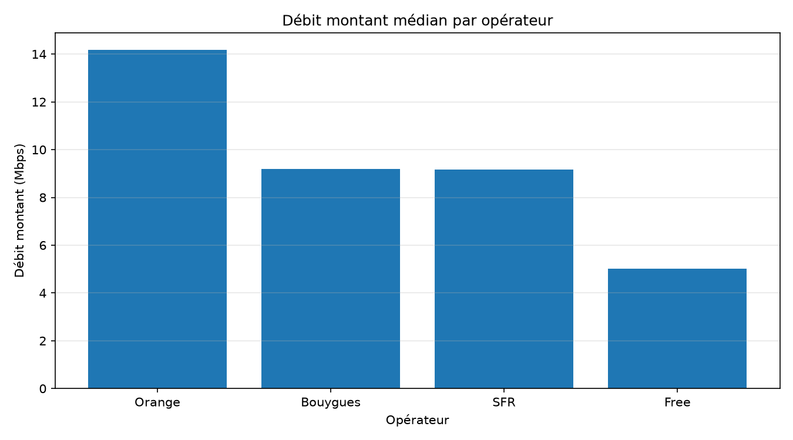
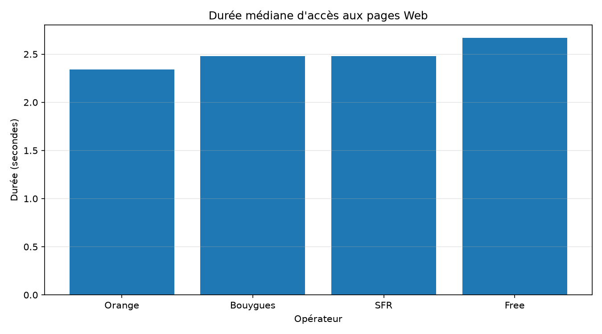
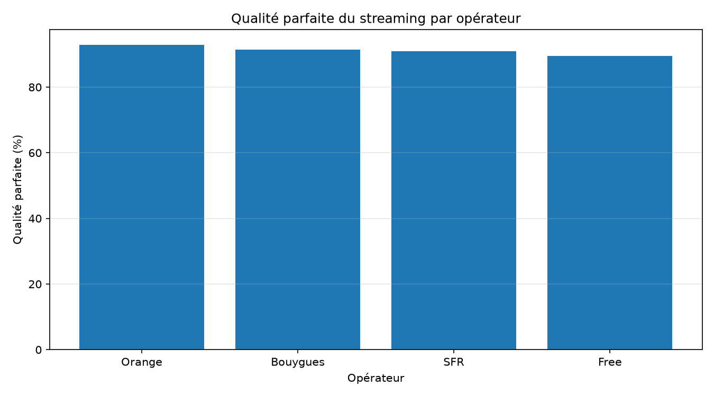
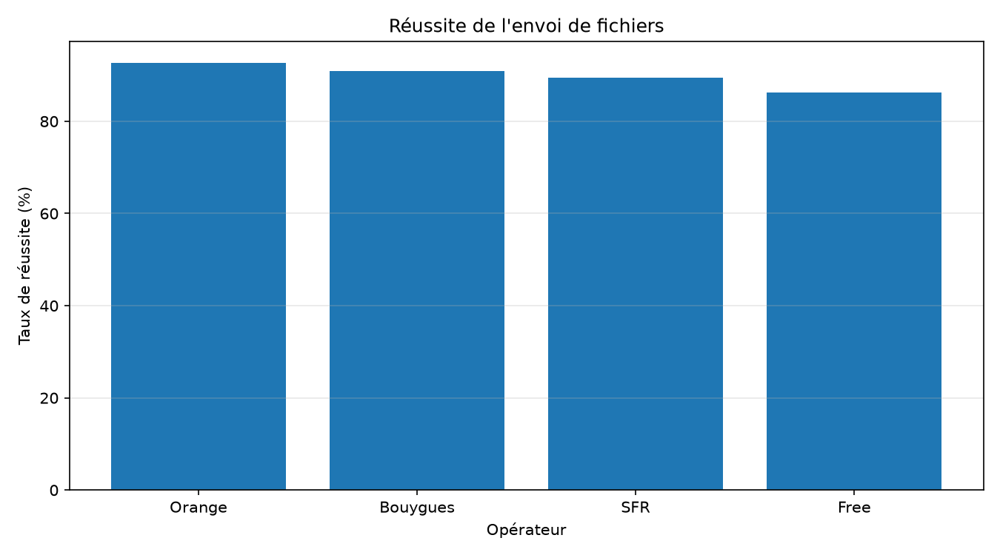

# Analyse des performances des réseaux mobiles en France

## 1. Présentation du projet

Ce projet consiste à analyser et comparer les performances des réseaux mobiles des quatre principaux opérateurs français :

- Orange
- SFR
- Bouygues Telecom
- Free Mobile

L'étude repose sur des données publiques de qualité de service des réseaux mobiles publiées par l'ARCEP pour la France métropolitaine en 2025.

L'objectif est de transformer des données brutes en informations exploitables afin de comprendre les différences de performances entre les opérateurs et les zones géographiques.

## 2. Problématique

Comment comparer les performances des opérateurs mobiles français selon les différents usages et les zones géographiques afin d'identifier les disparités de qualité de service ?

## 3. Objectifs de l'étude

Le projet vise à :

- Comparer les débits descendants et montants des opérateurs.
- Évaluer les performances de navigation Web.
- Analyser la qualité du streaming vidéo.
- Comparer les taux de réussite des envois de fichiers.
- Étudier les différences de performances selon les zones géographiques.
- Identifier les disparités de qualité de service entre les territoires.

## 4. Sources de données

### ARCEP – Qualité de service mobile 2025

Les données utilisées proviennent des mesures de qualité de service des réseaux mobiles réalisées en France métropolitaine.

Source :  
https://data.arcep.fr/mobile/mesures_qualite_arcep/2025/Metropole/

Période couverte par les mesures : du 26 mai 2025 au 2 septembre 2025.

## 5. Technologies utilisées

### Analyse et traitement des données
- Python
- Pandas
- NumPy
- Jupyter Notebook

### Base de données
- PostgreSQL
- SQL
- Psycopg2

### Visualisation
- Matplotlib

### Environnement de développement
- VS Code
- Git
- GitHub

## 6. Méthodologie

Le projet suit plusieurs étapes :

1. Exploration et compréhension des données avec Python et Pandas.
2. Identification et sélection des indicateurs pertinents.
3. Conception d'une base de données relationnelle avec PostgreSQL.
4. Importation des données du CSV dans PostgreSQL.
5. Vérification de la qualité et de la cohérence des données avec SQL.
6. Comparaison des performances des opérateurs selon les différents usages.
7. Analyse des différences de performances selon les zones géographiques.
8. Création d'une vue SQL regroupant les informations des différentes tables.
9. Création de visualisations avec Python et Matplotlib.

## 7. Usages étudiés

| Usage | Protocole | Indicateurs retenus |
|---|---|---|
| Débit descendant | DOWNLOAD | Débit de téléchargement |
| Débit montant | UPLOAD | Débit d'envoi |
| Navigation Web | WEB | Durée d'accès et indicateurs de chargement |
| Streaming vidéo | STREAM | Qualité vidéo correcte et parfaite |
| Envoi de fichier | ULH | Taux de réussite de l'envoi |

## 8. Architecture de la base de données

Le projet utilise une base de données relationnelle PostgreSQL composée de cinq tables :

- `staging_mesures` : stocke les données brutes importées depuis le CSV.
- `operateurs` : contient les informations sur les opérateurs mobiles.
- `protocoles` : contient les différents protocoles de mesure.
- `zones` : contient les catégories géographiques.
- `mesures` : stocke les mesures structurées avec leurs références vers les autres tables.

Une vue SQL appelée `vue_mesures_detaillees` permet de regrouper les informations des mesures, des opérateurs, des protocoles et des zones.

## 9. Principaux résultats

La base de données contient **336 954 observations**.

### Comparaison globale des opérateurs

Les analyses réalisées montrent que :

- Orange présente les meilleurs débits descendants et montants médians.
- Orange obtient globalement les meilleurs résultats en navigation Web.
- Orange présente le meilleur taux de qualité vidéo parfaite.
- Orange possède le meilleur taux de réussite pour l'envoi de fichiers.

### Comparaison géographique

L'analyse géographique met en évidence des différences de performances entre les zones denses, intermédiaires, rurales et touristiques.

Les zones rurales présentent généralement des performances plus faibles, notamment en matière de débits descendants et montants.

Orange obtient les meilleurs débits médians descendants et montants dans les quatre catégories géographiques étudiées.

## 10. Visualisation des résultats

Cinq graphiques ont été réalisés avec Python et Matplotlib afin de présenter les résultats des comparaisons entre opérateurs.

### Débit descendant



### Débit montant



### Navigation Web



### Qualité du streaming vidéo



### Réussite de l'envoi de fichiers



## 11. Organisation du projet

```text
mobile-network-performance-analysis/
│
├── analyses_jupyter/
│
├── database/
│   ├── 00_create_database.sql
│   ├── 01_schema.sql
│   └── 02_import_data.py
│
├── donnees/
│
├── documentation/
│
├── rapports/
│
├── sql/
│   ├── 01_controles_qualite.sql
│   ├── 02_analyses_operateurs.sql
│   ├── 03_analyses_zones.sql
│   └── 04_vues.sql
│
├── scripts/
│   └── 01_visualiser_resultats.py
│
├── figures/
│   ├── 01_debit_descendant.png
│   ├── 02_debit_montant.png
│   ├── 03_navigation_web.png
│   ├── 04_streaming.png
│   └── 05_envoi_fichier.png
│
├── requirements.txt
├── .env.example
├── .gitignore
└── README.md
```

## 12. Limites et perspectives d'amélioration

Les résultats présentés décrivent les observations disponibles dans le jeu de données étudié. Ils ne constituent pas une garantie des performances rencontrées par chaque utilisateur ou dans toutes les situations.

Les perspectives d'amélioration du projet comprennent :

- L'intégration de données supplémentaires provenant de l'ANFR sur les infrastructures mobiles.
- L'étude de la répartition géographique des antennes mobiles.
- L'analyse du déploiement des technologies 4G et 5G.
- L'étude du dispositif de couverture ciblée.
- La création de tableaux de bord interactifs avec Power BI.